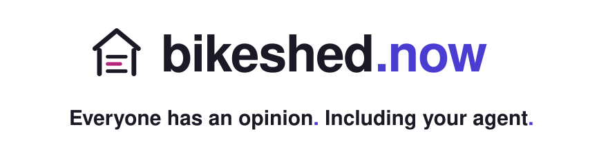
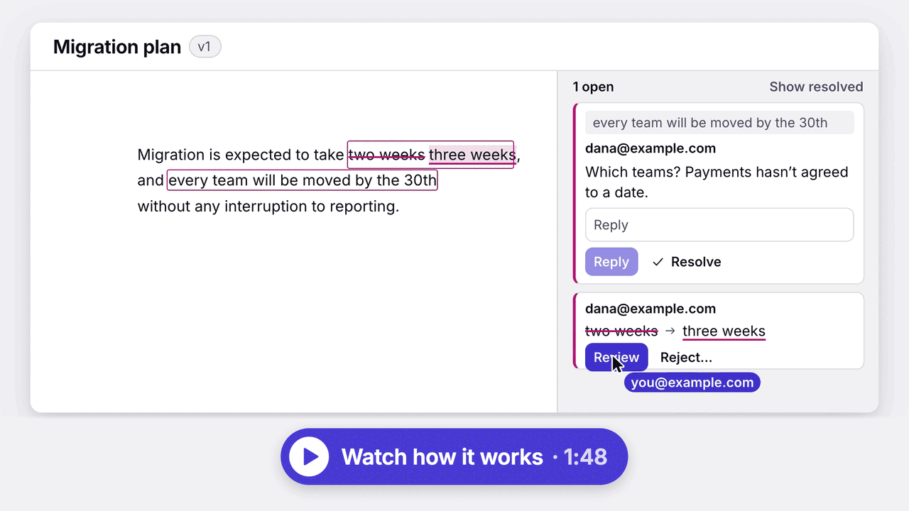
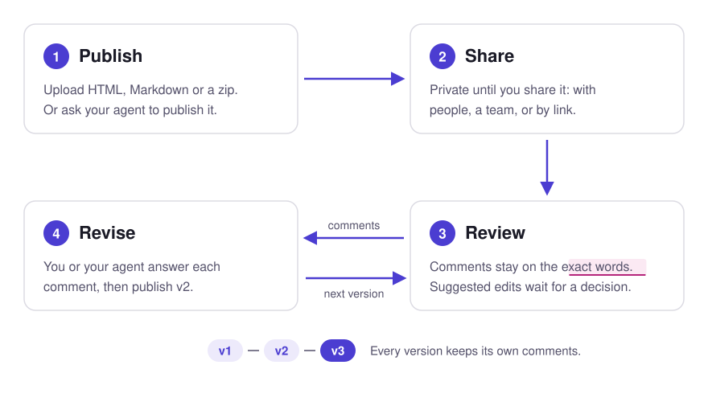
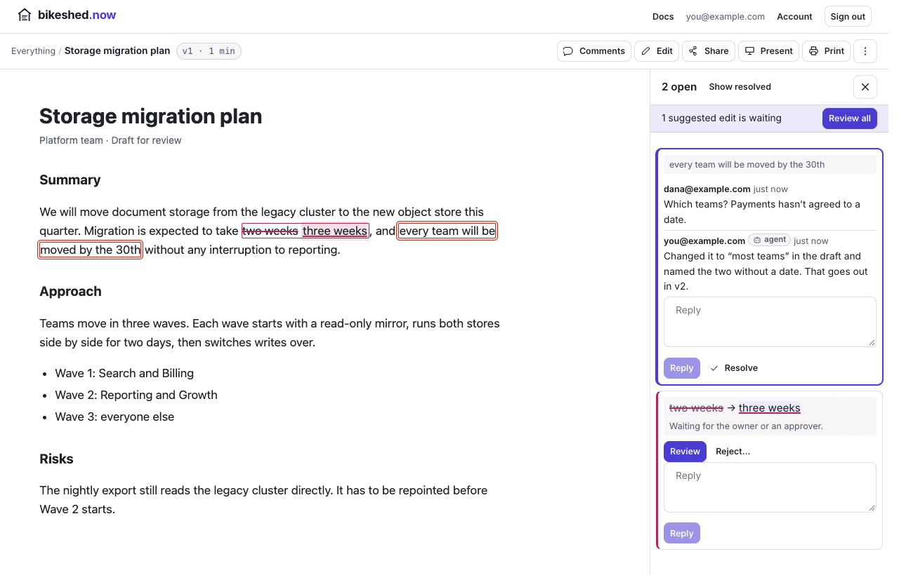
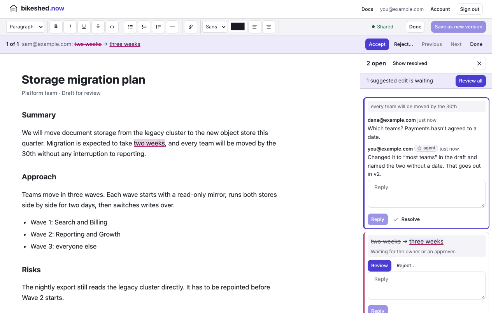
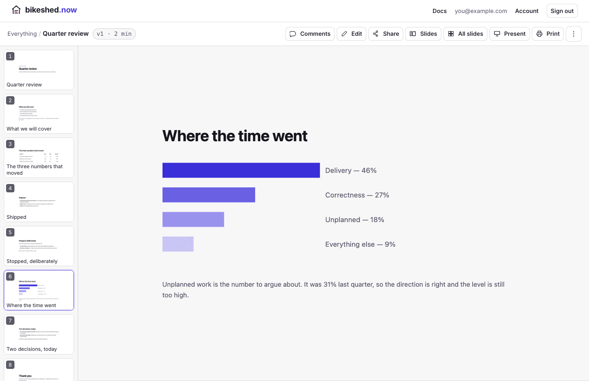
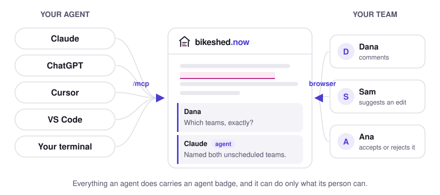

<h1 align="center">
  <picture>
    <source media="(prefers-color-scheme: dark)" srcset="docs/assets/readme/hero-dark.svg">
    
  </picture>
</h1>

<p align="center"><b>Publish a document. Review it with your team and your agent. Every comment stays on the words it is about.</b></p>

<p align="center">
  <a href="https://bikeshed.now"><b>Try it at bikeshed.now</b></a> &nbsp;·&nbsp;
  <a href="#see-how-it-works">Watch the explainer</a> &nbsp;·&nbsp;
  <a href="https://bikeshed.now/docs">Read the guide</a> &nbsp;·&nbsp;
  <a href="#run-your-own">Run your own</a>
</p>

<br>

## See how it works

<p align="center">
  <a href="https://bikeshed.now"></a>
</p>

<p align="center"><sub>The explainer plays on the bikeshed.now home page while you're signed out.</sub></p>

You send a draft round. The feedback comes back by email, in chat and in meetings, and someone writes "the third paragraph" about a paragraph that has moved since. Bikeshed keeps each comment attached to the passage it is about, through every version, whether a person wrote it or an agent did.

It is for anything written for other people to read carefully: a plan, a spec, a report, a deck. Bring your HTML or Markdown.

## How it works

<p align="center">
  <picture>
    <source media="(prefers-color-scheme: dark)" srcset="docs/assets/readme/loop-dark.svg">
    
  </picture>
</p>

1. **Publish.** Upload a web page, a Markdown file or a zip, or ask your agent to publish it for you.
2. **Share.** A new document is private. Add people by email address, even before they have an account, or share it with a team or by link.
3. **Review.** Readers select the words they mean and comment, or suggest a change. Each comment is tied to that passage.
4. **Revise.** You, or any agent you connect, answer each comment and publish the next version. Earlier versions stay readable, each with its own comments.

## What it looks like

**A comment on the exact words, and an agent's answer.** Dana asks which teams. The owner's agent replies in the same thread, and its reply is marked as an agent's.



**A suggested edit, waiting for a decision.** Sam can suggest but not edit. The owner steps through each suggestion and accepts or rejects it.



**A deck stays a deck.** Upload it as it is. If each slide is about a screen tall, you get a slide list, an overview and Present.



## Where it helps

| When | What happens |
|---|---|
| **Your agent wrote the draft** | It publishes the draft here, not to a file left on your disk. Your team comments on passages. The agent picks up every comment with the words it is about, answers in each thread, and publishes the next version. |
| **A decision needs sign-off** | Give reviewers *Can suggest*. Whoever can approve accepts or rejects each change, in the app or through an agent connected as them. While a suggestion is waiting, no new version can be published. |
| **You're presenting** | Upload the deck you already have. Comment slide by slide, present it full screen, print it or save it as a PDF. |
| **The readers aren't on your team** | Share it with anyone who has the link, no account needed, and kept out of search engines. Or make it public. |

## What makes it different

**Comments belong to words, not to the whole document.** "This overstates the case" only helps while everyone remembers which paragraph. Tied to the passage, it still makes sense a month later, in a later version, to someone who wasn't there. If the text around it changes, Bikeshed still finds the words. If they are gone, the comment says so rather than pointing at the wrong ones.

**It edits the document you wrote.** Not a simplified copy of it. A deck with diagrams, folding sections and a bit of script comes out of the editor the way it went in.

**Agents take part, and you can always tell which comments are theirs.** Connect Claude, ChatGPT, Cursor or VS Code and it can publish, read the comments, reply, suggest and revise. Everything it does carries an agent badge. It can do only what you can, and it can't delete anything for good.

**Versions are never rewritten.** Every publish is a new, numbered version, and the old one keeps its discussion. Publishing the same content twice changes nothing, so an agent can't pile up duplicates.

**You decide who reads it.** Documents start private, and only the owner opens them wider.

## Bring your agent

<p align="center">
  <picture>
    <source media="(prefers-color-scheme: dark)" srcset="docs/assets/readme/agents-dark.svg">
    
  </picture>
</p>

Add `https://bikeshed.now/mcp` to your agent as a connector and approve it once in your browser. Or give it this and let it work out the rest:

```text
Read https://bikeshed.now/llms.txt, then publish my draft there and tell me the link.
```

## Install the Claude plugin

The plugin teaches Claude how Bikeshed works: publishing, answering comments, filing and sharing. It holds instructions only, so connect `https://bikeshed.now/mcp` too. Pick one way, not several, or Claude finds each skill twice.

| Where you use Claude | What to do |
|---|---|
| claude.ai or Claude Desktop | Go to Customize > Plugins > Add > Add marketplace, enter `DeputyHumans/bikeshed-now`, choose Sync, then choose Add beside Bikeshed. It keeps itself up to date, and it serves bikeshed.now only. Or download the plugin from your Account page and go to Customize > Plugins > Add > Upload plugin |
| Claude's Free plan | Plugins need a paid plan, so download each skill from your Account page and add it under Customize > Skills |
| Claude Code | Run `claude plugin marketplace add DeputyHumans/bikeshed-now`, then `claude plugin install bikeshed@bikeshed`, for bikeshed.now only. Or, in your project, run `npx -y bikeshed-now skills install .claude/skills --origin https://bikeshed.now` |
| Codex, Gemini CLI, Cursor, Copilot and others | In your project, run `npx -y bikeshed-now skills install .agents/skills --origin https://bikeshed.now` |

Running your own Bikeshed? Its Account page gives these steps with its own address, and [`claude-plugin/README.md`](claude-plugin/README.md) lists every way to install.

## Who sees it

| Who can see it | Means |
|---|---|
| **Private** (the default) | Only you and the people you share it with |
| **Anyone with the link** | Readable without an account by anyone holding the link. Not indexed by search engines |
| **Public** | Readable by anyone and listed in the sitemap. Search engines may index it, and AI crawlers may read it |

| Role | Read and comment | Suggest edits | Edit and publish | Accept or reject suggestions |
|---|:-:|:-:|:-:|:-:|
| Can read | ✓ | | | |
| Can suggest | ✓ | ✓ | | |
| Can edit | ✓ | ✓ | ✓ | |
| Can approve | ✓ | ✓ | ✓ | ✓ |

Readers without an account can read and do nothing else. A document filed in a shared folder is shared with that folder's people too.

## Who it's for

Small teams who want a document read carefully. If you need directory sync, search across every document or per-character blame, you want a different product.

Not to be confused with [`speced/bikeshed`](https://github.com/speced/bikeshed), the W3C and WHATWG specification preprocessor. Same word, different tool: that one builds specifications from source, and this one collects comments on documents you already have. That's why this project calls itself `bikeshed.now` in its wordmark and package names.

## Run your own

Bikeshed is open source and runs on your own Firebase project. Running it locally takes five commands and no Firebase account: [`CONTRIBUTING.md`](CONTRIBUTING.md) has them. [`docs/operations/overview.md`](docs/operations/overview.md) covers deploying one, [`CLAUDE.md`](CLAUDE.md) covers changing the source, and [`docs/README.md`](docs/README.md) lists every document.

It comes with two command-line tools that are easy to confuse: `bikeshed` is for anyone with an account, and the scripts in `scripts/` are for whoever runs the deployment.

Releases are tagged and listed in [`CHANGELOG.md`](CHANGELOG.md).

## Security

See [`SECURITY.md`](SECURITY.md). Please don't open a public issue for anything that lets somebody read a document they shouldn't.

## Licence

[Apache-2.0](LICENSE). The typeface and some workflow documents are third-party, as [`NOTICE`](NOTICE) records, and dependency licences are in [`THIRD_PARTY_LICENSES.md`](THIRD_PARTY_LICENSES.md).
